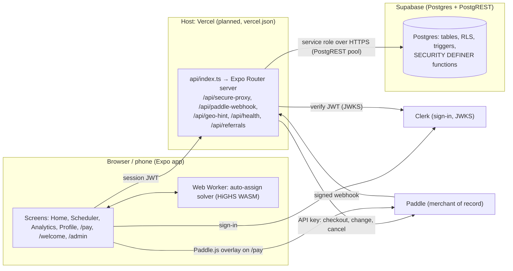

# Where everything lives (stack map)

Last checked: 2026-11-25 (CHG-109). Each claim below says how it was checked. "Not set up" means no evidence of it was found, not that it is impossible.

## Components

| Part | Where | Status (how checked) |
|---|---|---|
| Source code | GitHub `PillB/horario-app`, default branch `main` | Live |
| Web app build | `expo export -p web` → `dist/client` (static) + `dist/server` (API routes) | CI job "Typecheck, lint, unit tests, web build" builds it on every PR |
| Hosting | Vercel, configured by `vercel.json` (one Node function `api/index.ts`, security headers, CSP) | **Not deployed.** GitHub shows no Vercel deployments for the repo; the project import is step 3 of `/mnt/project-files/plan/cloud-setup-checklist.md` |
| Domain | `equipara.app` (chosen name; `equipara.dev` redirect only) via Cloudflare | **Not bought yet** (Cloudflare setup thread, 2026-11-02, phase A) |
| Database (dev) | Supabase project `horario-dev` | **Not connected.** The "Database migrations" workflow runs on every merge to main but logs "Dev Supabase secrets are not set; skipping migrations" (run of 2026-11-25) |
| Database (prod) | Supabase project `horario-prod` | Not created; migrated only by a manual run of `migrate.yml` with the "production" environment |
| Database (local and CI) | `supabase start` (Docker), migrations in `supabase/migrations/`, pgTAP in `supabase/tests/database/` | Used by the CI jobs "Database isolation tests" and "Browser tests" |
| Auth | Clerk. Dev instance used so far; prod instance needs the domain | Server: `server/proxyAuth.ts` verifies JWTs against `CLERK_JWKS_URL`, fails closed |
| Payments | Paddle (sandbox first) | Code merged (CHG-104), switched off until `EXPO_PUBLIC_CHECKOUT_ENABLED=1`; owner steps in `docs/manual-setup/SETUP_PADDLE.md` |
| Background workers | None on a server. The only "worker" is the browser's Web Worker for the solver (`services/optimizer/solverWorker.ts`) | There is no job queue, cron or message dispatcher; `shift_messages` rows stay `pending` |
| Planned later | Cloudflare Worker + CP-SAT optimiser on Cloud Run; Resend email; Expo push | `/mnt/project-files/product/setup-handoff.md` §3–4 |
| CI | `.github/workflows/ci.yml` (4 jobs), `migrate.yml`, `labor-drift.yml` (weekly) | Green on PR #67 |

## Connections and pooling

The server never opens a Postgres connection. Each request builds a supabase-js client (`server/serviceClient.ts`) that talks HTTPS to PostgREST, and PostgREST keeps its own pool. A pooled connection string (Supavisor) only matters if direct Postgres access is added later. Every advisory lock is `pg_advisory_xact_lock` inside one function call, so it is also safe behind a transaction-mode pooler. Never add session-level locks.

## Where the documentation is

| What | Where |
|---|---|
| How to work here (rules, standards) | `CLAUDE.md`, `AGENTS.md` (repo root) |
| Every change and decision | `Claude_changes.md` (CHG-### entries), `Research_changes.md` |
| State machines (this audit) | `docs/architecture/STATE_MACHINES.md` |
| Owner setup steps | `docs/manual-setup/` (Supabase, Clerk, Vercel, Paddle) and `/mnt/project-files/plan/cloud-setup-checklist.md` |
| Research, QA, marketing, product decisions | Project files: `/mnt/project-files/{research,qa,marketing,product,plan}/` |
| Pricing research | `docs/pricing/`, `/mnt/project-files/product/` |

## Secrets

Secrets live only in the host's environment settings (Vercel) and GitHub Actions secrets, never in the repo or `EXPO_PUBLIC_*` variables. The list of variables is CLAUDE.md §9.
