# State machines in Horario

Audit of 2026-11-25 (CHG-109). Most of the app's state machines are implicit: a mix of booleans, nullable fields, refs, database columns and triggers that together encode a mode. Each section below names the machine, says where its state lives, draws it, and lists what was wrong and what changed. "Open" items are known and not fixed yet.

Map:

| # | Machine | Lives in | Kind |
|---|---|---|---|
| 1 | Stored list (load, refresh, optimistic write) | `hooks/usePersistedList.ts` | client |
| 2 | Auto-assign run, suggestions, apply | `hooks/useSchedulerHandlers.ts`, `components/scheduler/ShiftTemplateSection.tsx` | client |
| 3 | Solver worker | `services/optimizer/autoAssignClient.ts` | client |
| 4 | Demand targets and forecast | `hooks/useDemandForecast.ts` | client |
| 5 | Screen freshness (what reloads what) | `hooks/useRefreshOnFocus.ts` and each screen | client |
| 6 | Edit forms (`ifUpdatedAt`) | `useSchedulerHandlers`, `useWorkers`, `useShiftTemplates`, proxy `updateOrInsert` | client + server |
| 7 | Onboarding checklist | `useSchedulerHandlers`, trigger `onboarding_progress_keep_done` | client + database |
| 8 | Guided tour | `contexts/WelcomeTourContext.tsx` | client |
| 9 | Roster row (Draft, Published, told) | `roster` table, triggers, proxy roster actions | database |
| 10 | Account plan (trial, grants, subscription) | `server/plans.ts`, `account_entitlements`, `subscriptions` | server + database |
| 11 | Paddle events | `paddle_events`, `apply_paddle_subscription`, `record_paddle_event` | database |
| 12 | Monthly auto-assign counter | `usage_limits`, `consume_auto_assign`, `apply_auto_assign` | database |
| 13 | Demand target model vs override | trigger `demand_targets_keep_override` | database |
| 14 | Shift messages | `shift_messages` | database |
| 15 | Checkout and billing actions | `server/billing.ts`, `app/pay.tsx` | server + client |

---

## 1. Stored list

`usePersistedList` backs workers, templates, roster and days off. Each list has one load state and, per row, a write state.

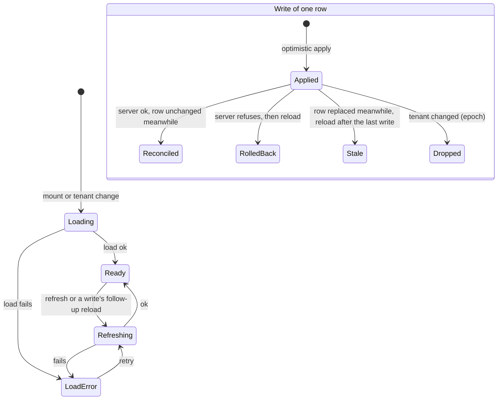

Fixed (CHG-109): in the render where the tenant changes, the hook returned the previous tenant's rows with `loaded = true`, so an effect in that render (the tour's sample-data seeding) could act on the wrong account. It now returns no rows and `loaded = false` until the new tenant's load ends. `getItems()` reads the current rows without a stale closure.

Open: the error message is not cleared when a retry starts; a hung request has no timeout.

## 2. Auto-assign run, suggestions, apply

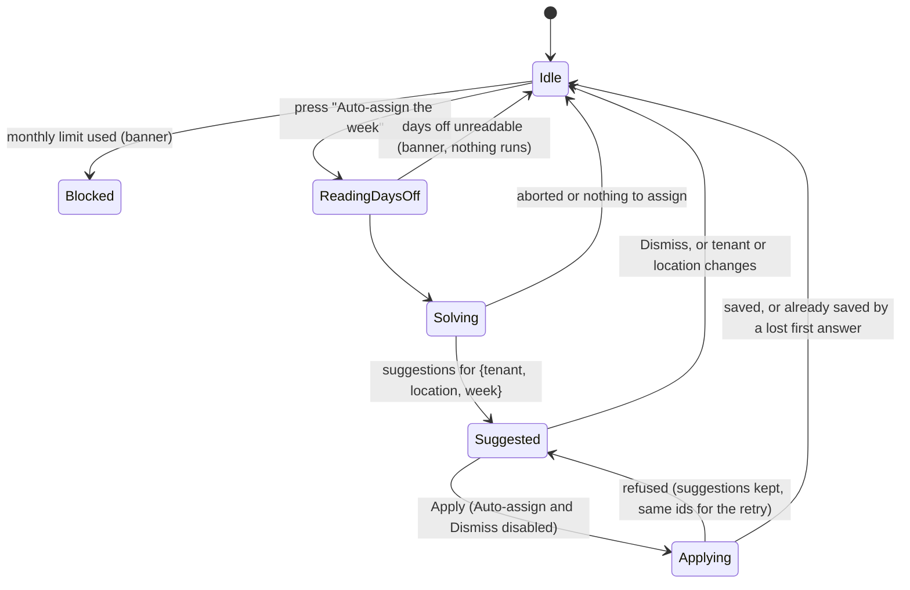

Fixed (CHG-109): suggestions were applied under whatever location was picked at apply time, not the one the run used for its law and time zone; they could not be dismissed; Auto-assign stayed clickable during Apply, and a retry after a lost answer minted new ids. Suggestions now carry their tenant and location, keep their ids until saved, and the server recognises a retried batch (machine 12).

## 3. Solver worker

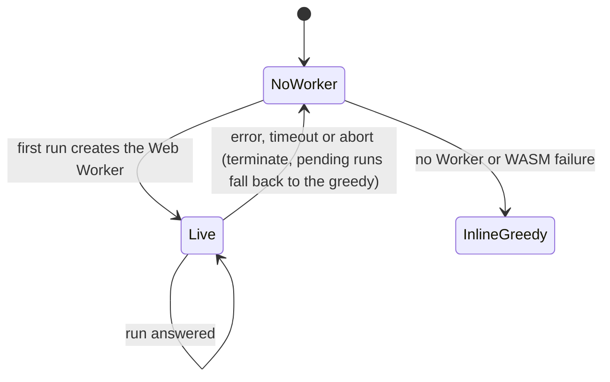

No defect found. A timeout runs the greedy on the main thread (brief UI pause).

## 4. Demand targets and forecast

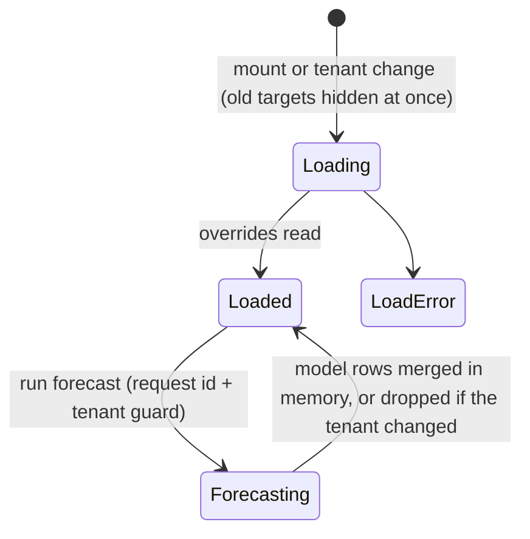

Fixed (CHG-109): the hook had no tenant key, so after switching organisation the Scheduler kept the previous organisation's targets and forecast.

## 5. Screen freshness

Each screen loads its own copy of the data (no shared cache, no realtime). What keeps them aligned is reloading when a screen comes back into view.

| Screen | Reloads on |
|---|---|
| Home | mount, tenant, focus: roster summary, posting habit, **locations** |
| Scheduler | mount, tenant, retry, its own writes, focus: **locations, usage count, plan banner** |
| Analytics | mount, tenant, period, focus: **all data and insights** |
| Profile | mount, tenant, focus: **plan and locations** |

Fixed (CHG-109): only Home reloaded on focus. After adding a location on Profile, Home still offered the "set up your location" card (and saving it made a second location or a 402); after a plan change only the plans dialog refreshed; Analytics showed old numbers until reload. `useRefreshOnFocus` skips the first focus so nothing loads twice on mount.

Also fixed: the same gap figure was computed three ways. The Scheduler added each template's coverage per shift and counted drafts and unsaved forecast rows; Home and Analytics counted one per published shift against stored targets. `utils/staffingGaps.ts` is now the only rule: stored targets, published shifts, one per shift, per date and role.

Also fixed: Analytics and the capacity outlook read through functions that return an empty list on failure, so a failed load showed 0% coverage as a fact. They now show the error, and a notice when a list was cut short.

## 6. Edit forms

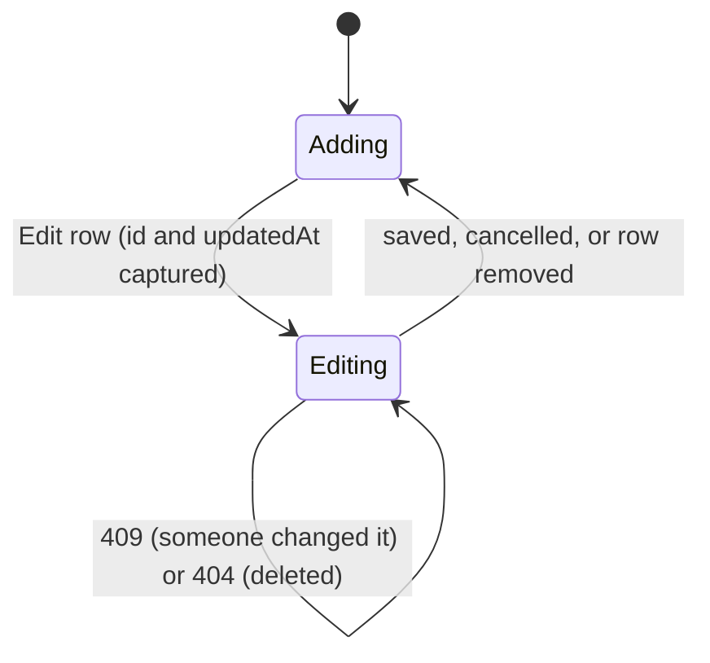

Fixed (CHG-109): the save read `updatedAt` from the list at save time. If the list reloaded in between (after any failed write or a retry), another device's change was silently overwritten. The value captured at Edit is sent now; the server compares it inside the UPDATE.

Open: without `ifUpdatedAt` the server still re-inserts a row deleted meanwhile (workers, templates); a retried single add can create a duplicate worker (no natural key).

## 7. Onboarding checklist

A step goes from not done to done and never back (database trigger). Fixed (CHG-109): "done" was derived from optimistic rows and unsaved forecast rows, so a refused add was stored as done for good. Only rows the server confirmed, and stored targets, count now.

## 8. Guided tour

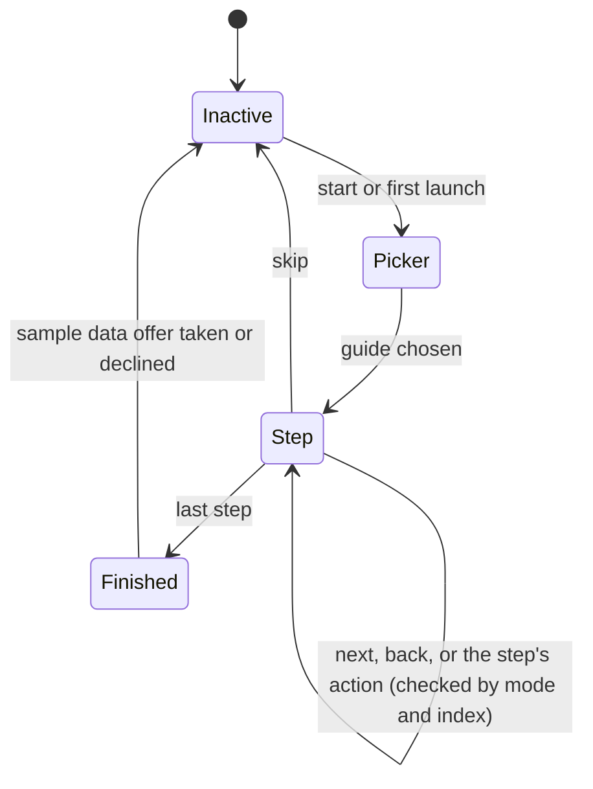

Sample rows are seeded only after the workers list loaded empty, without error and not truncated (CHG-109 added the truncated check).

## 9. Roster row

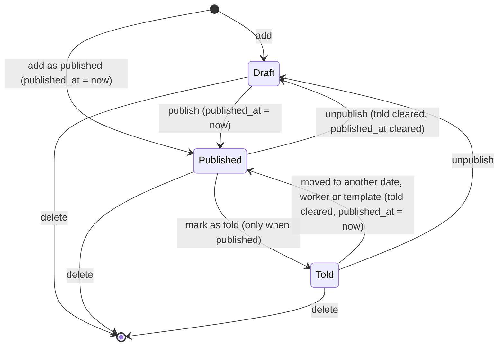

Guards: one row per (account, date, worker, template) (409); no overlapping shifts for one worker, per-account lock (409); worker and template must exist.

Fixed (CHG-109): a published shift moved to another day kept its first publish time, so a late change looked posted early; it now gets a new one, and the trigger clears "told" for every writer, since the person was told about the old shift. A CHECK constraint makes "told" impossible on a draft for every writer, not only the proxy.

Open: the overlap check uses wall-clock times (no time zone or daylight saving); rest and hour limits are checked only in the browser; a shift on a stored day off is allowed when added by hand.

## 10. Account plan

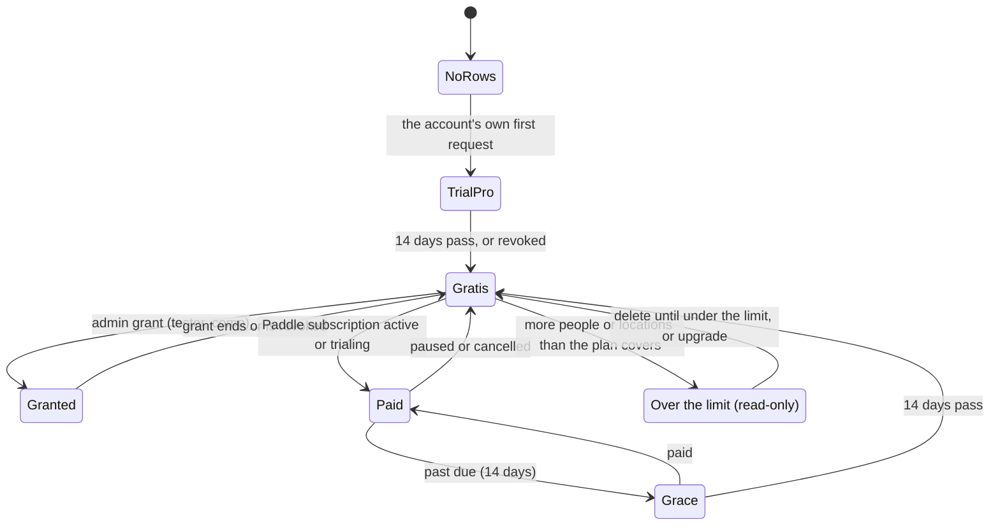

Fixed (CHG-109): more locations than the plan covers (after a trial, a grant or a downgrade) was never enforced, so per-location pricing could be bypassed for good; it is now read-only like the people limit (deletes and billing stay open). A plan that cannot be read now refuses gated actions with 503 instead of letting them through without limits; deletes need no plan read and stay open. An admin looking up an account id no longer starts that account's one trial.

Open: an active subscription whose period ended long ago still counts if Paddle's cancel webhook was lost for good (needs a daily reconcile job, which Paddle recommends); a new Clerk organisation gets a new trial.

## 11. Paddle events

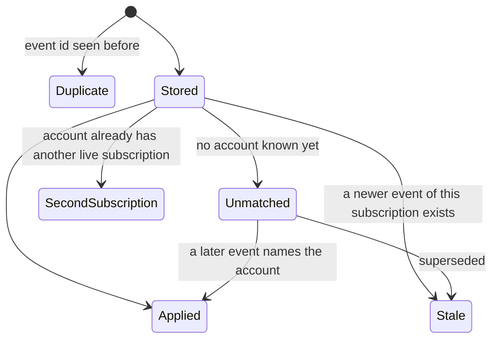

Per subscription one delivery at a time (lock), then the account lock (CHG-107). Order is decided by Paddle's `occurred_at`, as Paddle's docs require, because delivery order is not guaranteed.

Open: a `second_subscription` is never promoted when the first one ends; an event whose price id is unknown is stored with 200 and cannot be replayed; two quick checkouts can create two subscriptions. These matter once checkout is switched on.

## 12. Monthly auto-assign counter

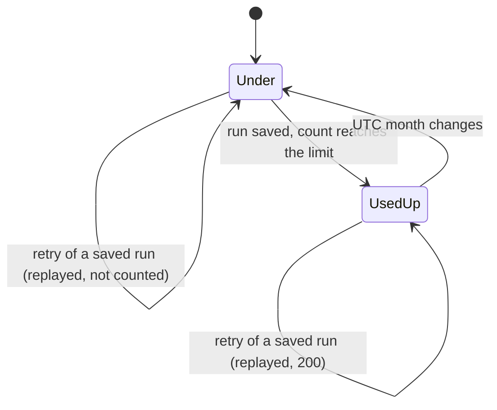

Fixed (CHG-109): a retry after a lost answer was counted again or refused with "already used, nothing was added" although the first attempt had saved the week. A batch is a replay only when every row is already stored with the same id, date, worker and template; reused ids for other shifts fail with 409 (ids are fresh per run, so this only guards against a future change). A member could use up the manager's monthly run through `incrementAutoAssign`; it is manager-only now.

Open: the month boundary is UTC, not the business's time zone.

## 13. Demand target model vs override

A stored override is never replaced by a forecast row (trigger). Removing an override leaves no target for that date until the next forecast. No defect.

## 14. Shift messages

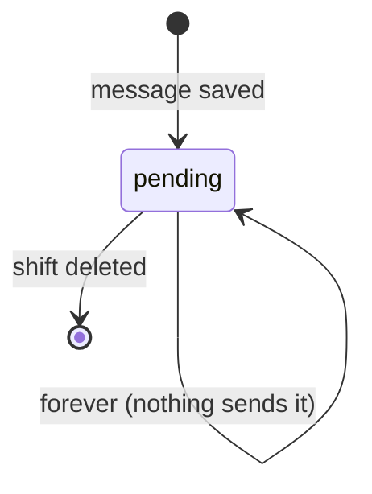

`sent`, `failed` and `delivered` are allowed by the table but unreachable: there is no delivery channel yet. When push or email is built, this table should become a transactional outbox: the message row is written in the same transaction as the change, a worker claims rows with `FOR UPDATE SKIP LOCKED`, sends with an idempotency key, retries with backoff, and marks the row sent; "told" should follow delivery instead of a button.

## 15. Checkout and billing actions

The proxy never writes the database when it calls Paddle; the webhook is the only writer of paid plans. That is why no outbox is needed there: there is no half-done "database written, API not called" state. `/pay` moves loading → open → paid, closed or failed.

Open: if Paddle.js loads but never opens, `/pay` stays on loading with no way back; after paying, Profile shows the old plan until the webhook lands and the screen regains focus.

---

## Patterns used and why

- **Optimistic locking**: edits send the row's `updated_at` exactly as read and the UPDATE compares it (409 on change, 404 on delete). Chosen over a version column because every edited table already has a trigger-maintained `updated_at`.
- **Pessimistic advisory locks** (`pg_advisory_xact_lock`) where a rule depends on other rows: plan limits, overlap, auto-assign count, Paddle deliveries. Always transaction-scoped, always in a fixed order.
- **Idempotency by client id**: a create keeps its id until saved; a retried auto-assign batch is recognised by its ids; Paddle events by event id.
- **Event ordering by source time** (`occurred_at`), never by arrival.
- **Connection pooling**: not needed in the app server (it talks HTTPS to PostgREST, which pools). See `STACK.md`.
- **Transactional outbox**: not needed today; required for message delivery when it is built (section 14).
